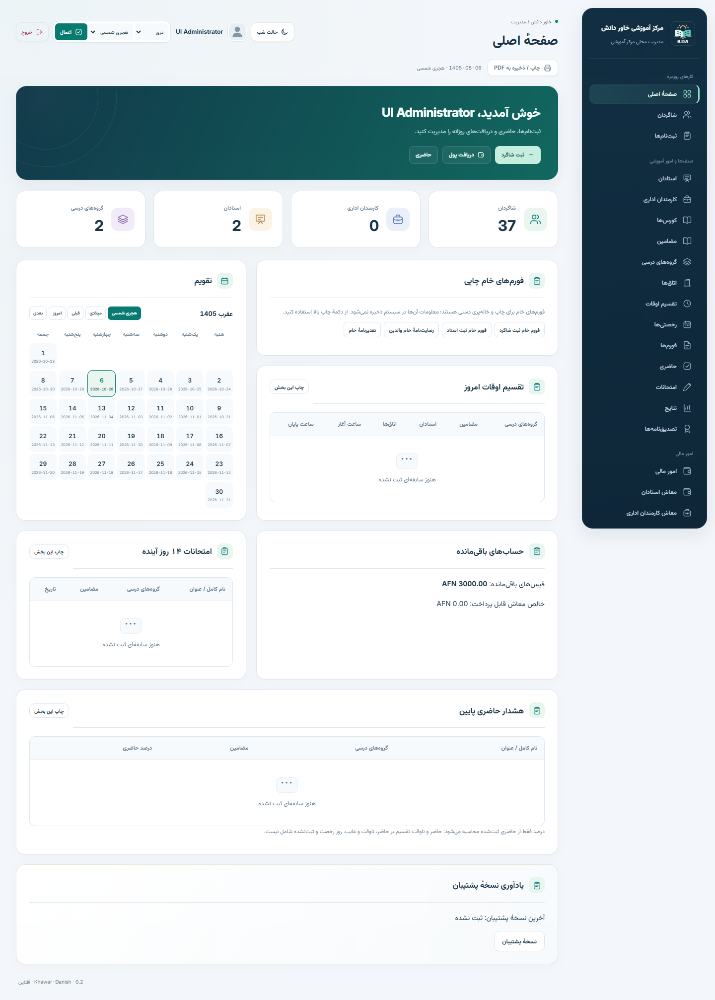

<div dir="rtl">

<p align="center"></p>

# خاور دانش — سیستم مدیریت مرکز آموزشی

**Khawar-Danish MIS** یک سیستم محلی PHP و MySQL برای مدیریت شاگردان، اساتید، کارمندان اداری و امور مالی مرکز آموزشی است. رابط دریِ راست‌به‌چپ، انگلیسی، تقویم هجری شمسی و میلادی، حالت روز و شب و فونت‌های کاملاً آفلاین دارد.

[English README](README_EN.md) · [راهنمای نصب](docs/INSTALLATION_FA.md) · [آپلود به GitHub](docs/PUBLISHING_FA.md)

## امکانات

- ثبت شاگرد و استاد با عکس، مشخصات و معلومات تذکره؛ فیلدهای کاغذی فقط برای تذکرهٔ کاغذی نمایش داده می‌شوند.
- استخدام کارمندان اداری، معاش ماهانه، تاریخ شروع/ختم کار و حساب ورود مرتبط؛ هر کارمند یک حساب دارد و مدیر اصلی استثنا است.
- کورس، مضمون، اتاق و گروه درسی با استاد، روز و ساعت؛ جلوگیری از تداخل برنامه و محدودیت ظرفیت.
- ثبت‌نام، ختم دوره و انتقال؛ فیس، پرداخت قسطی، پیش‌پرداخت، رسید، تخفیف و بازپرداخت.
- قرارداد و معاش استادان؛ معاش جداگانهٔ اداری با محاسبهٔ روزهای استخدام، تأیید ماه و پرداخت قسطی.
- حساب صندوق/بانک، عواید و مصارف، انتقال، تطبیق صندوق و گزارش نقدی.
- حاضری، ثبت ماهانه، ورق کاغذی حاضری، امتحان، نمرات، کارت نتیجه و تصدیق‌نامه.
- چاپ سند یا بخش انتخاب‌شده، خروجی CSV، بکاپ ZIP، بازیابی محلی و سوابق فعالیت.
- جستجو، مرتب‌سازی جدول‌ها، منوی آیکون‌دار، نمایش موبایل و رعایت تنظیم کاهش حرکت دستگاه.

## پیش‌نمایش

تصویر زیر مربوط به محیط آزمایشی با معلومات ساختگی است؛ شامل دیتای واقعی مرکز نیست.



## نیازمندی‌ها

| مورد | نیاز |
|---|---|
| PHP | نسخهٔ ۸٫۲ یا جدیدتر، ۶۴ بیتی |
| افزونه‌های PHP | PDO MySQL، Zip، Fileinfo و Sessions |
| دیتابیس | MySQL 8+ یا MariaDB 10.4+ با InnoDB و utf8mb4 |
| وب‌سرور | Apache 2.4؛ نصب محلی Windows با Wampserver راهنمایی شده است |
| مرورگر | Chrome یا Edge جدید؛ چاپگر اختیاری |

در زمان استفاده، اینترنت، Composer، Node، Docker و سرویس ابری لازم نیست. پیش‌نیازها باید از قبل نصب باشند. فونت‌های وزیرمتن و Inter داخل پروژه‌اند؛ Node و Python فقط برای بعضی آزمون‌های توسعه استفاده می‌شوند.

## نصب روی دیتابیس خالی

۱. پروژه را به `C:\Khawar-Danish` منتقل و Apache و MySQL را فعال کنید.
۲. دیتابیس و حساب مجازِ مخصوص آن را بسازید.
۳. `config/config.example.php` را به `config/config.php` کاپی و اتصال خودتان را تنظیم کنید.
۴. پوشه‌های `storage/logs`، `storage/backups`، `storage/uploads` و `storage/sessions` باید موجود و قابل نوشتن باشند.
۵. در پوشهٔ پروژه، با مسیر PHP نصب‌شده اجرا کنید:

```powershell
php bin/console.php install
php bin/console.php admin
```

دستور اول تأیید `INSTALL` می‌خواهد و فقط برای دیتابیس خالی است. دستور دوم نام، نام کاربری و رمز مدیر را از شما می‌گیرد؛ **حساب یا رمز پیش‌فرض وجود ندارد**. اگر PHP در PATH نیست، مسیر کامل آن را طبق راهنمای نصب استفاده کنید.

۶. در Apache فقط پوشهٔ `public/` را منتشر کنید؛ نه تمام پروژه. با Alias توضیح‌داده‌شده، آدرس محلی این است:

```text
http://localhost/khawar-danish/
```

[مراحل کامل نصب، تنظیم Apache و به‌روزرسانی](docs/INSTALLATION_FA.md)

## ترتیب آغاز کار

تنظیمات مرکز ← استخدام کارمند اداری ← ساخت حساب از لیست کارمندان ← بررسی صندوق ← اتاق ← کورس ← مضمون ← استاد ← گروه درسی ← قرارداد استاد ← شاگرد و ثبت‌نام ← فیس، حاضری و امتحان.

- فیس گروه فقط مرجع است؛ فیس توافق‌شده را در ثبت‌نام بنویسید. فیس ماهانه خودکار تکرار نمی‌شود.
- معاش‌ها بر ماه میلادی محاسبه می‌شوند. تأیید معاش به معنی پرداخت نیست.
- نوع تذکره، شماره، ولایت و تاریخ صدور ثبت می‌شود؛ جلد، صفحه و شمارهٔ ثبت فقط برای نوع کاغذی است.
- حساب‌های عادی ورود از کارمندان اداری ساخته می‌شوند؛ از پروفایل استاد حساب ورود ساخته نمی‌شود.

## راهنماها

- [راهنمای دری کاربران با سناریوی عملی](docs/USER_GUIDE_DARI.html)
- [راهنمای مدیر](docs/ADMIN_GUIDE_DARI.html)
- [نصب دری](docs/INSTALLATION_FA.md) و [English installation](docs/INSTALLATION_EN.md)
- [آزمون‌ها و حدود بررسی](docs/TESTING.md)
- [بکاپ و ریست با حفظ مدیر](docs/RESET_DATABASE_DARI.md)
- [مجوز فونت‌ها و وابستگی‌ها](licenses/DEPENDENCIES.md)

برای دیدن راهنماهای HTML، فایل را دانلود و در مرورگر باز کنید؛ GitHub آن‌ها را مانند برنامهٔ PHP اجرا نمی‌کند.

## کد پروژه با دیتای مرکز فرق دارد

نسخهٔ مخزن فاقد رمز واقعی، عکس اشخاص، دیتای عملیاتی، فایل نشست و بکاپ است. `database/001_schema.sql` ساختار و تنظیمات اولیه است؛ `database/demo.sql` فقط معلومات ساختگیِ اختیاری دارد. فایل‌های محلی حساس در `.gitignore` مستثنا شده‌اند؛ این فایل جلوی آپلود دستیِ فایل اشتباه از مرورگر را نمی‌گیرد.

بکاپ‌ها محرمانه‌اند و رمزگذاری خودکار ندارند. بکاپ زمان‌بندی‌شده موجود نیست؛ بازیابی از ابزار محلی انجام می‌شود. ریست یک کار اختیاری و مخرب است؛ برای نصب یا آپلود عادی اجرا نمی‌شود. توضیح مسئولانهٔ آسیب‌پذیری در [SECURITY.md](SECURITY.md) آمده است.

## بررسی‌ها

PHP lint، ۳۰ آزمون محاسبات و تاریخ، آزمون‌های مرورگر در محیط جدا، و سناریوی MySQL برای معاش اداری، پرداخت، بکاپ، بازیابی و ریست اجرا شده‌اند. فایل CI بررسی PHP و بستهٔ پاک را اجرا می‌کند؛ آزمون‌های مرورگر و MySQL دستور جدا دارند. این بررسی‌ها به معنی ممیزی مستقل امنیتی یا تأیید هر محیط سرور و چاپگر نیستند.

```powershell
php tests/unit.php
python tests/static_check.py
```

دستور دوم باید روی نسخهٔ پاکِ مخزن اجرا شود؛ در نصب زنده، وجود `config/config.php` عمداً بررسی انتشار را ناموفق می‌کند.

## مجوز

کد با [MIT](LICENSE) منتشر می‌شود. فونت‌ها مجوزهای جداگانهٔ همراه در `licenses/` دارند. محیط اجرا و Wampserver در این مخزن توزیع نمی‌شوند.

</div>


Schedule, attendance, student activity and teacher salary update (29 October 2026)

Identical subject/time/room/date ranges display once with all teaching weekdays. Daily conflict validation is preserved. Monthly attendance and paper sheets show each weekday beside its day number.
Issued completion and appreciation certificates also include English recognition text. Names retain their stored spelling.
Dashboard active/inactive counts and expandable full lists are derived on every visit. Active means an administratively active student with an active enrollment in an active batch covering today; both enrollment and batch dates apply. Ended courses automatically cease qualifying; renewal in a current course restores activity. Payment alone does not establish activity. New students without a current enrollment and future-only enrollments are inactive for now.
Teacher fixed salary uses agreed amount / 30 × covered calendar days, rounded to cents. A 3000 AFN amount yields 2800 for 28 days and 3100 for 31 days. Partial contracts count only covered days. Previously approved payroll remains unchanged. Payroll periods use Gregorian months. Administrative employee payroll is unchanged.
